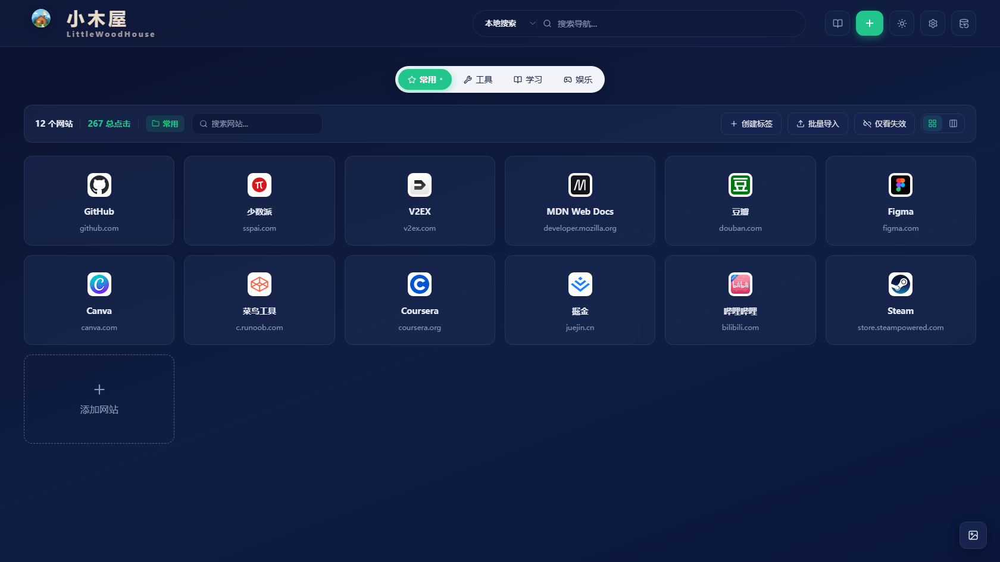
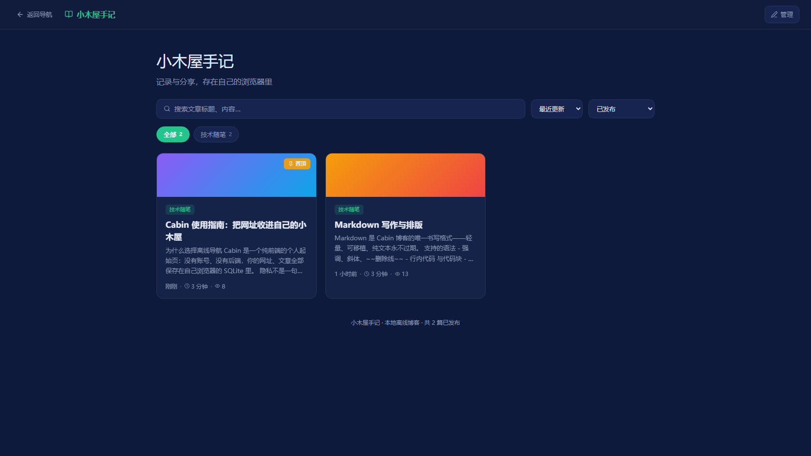
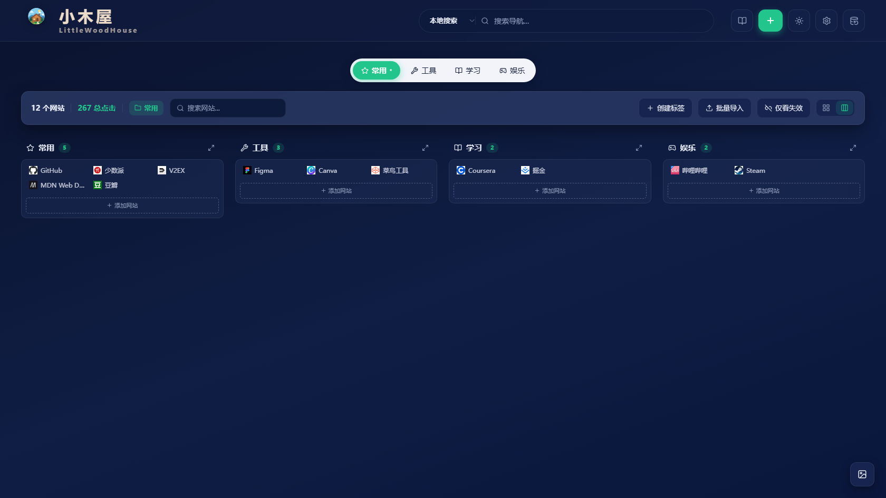
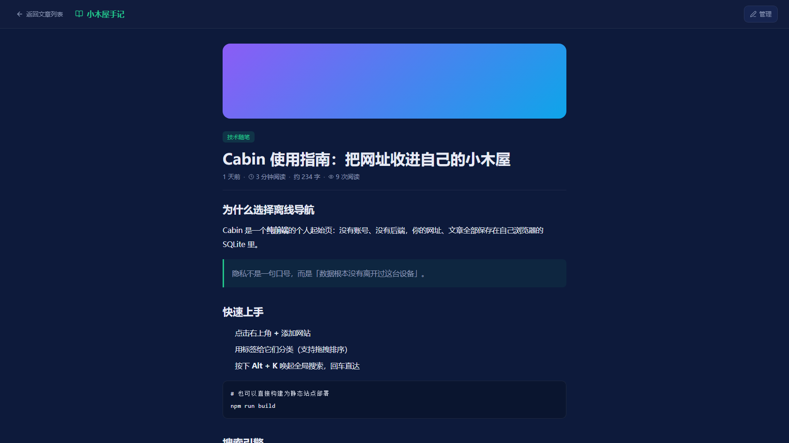
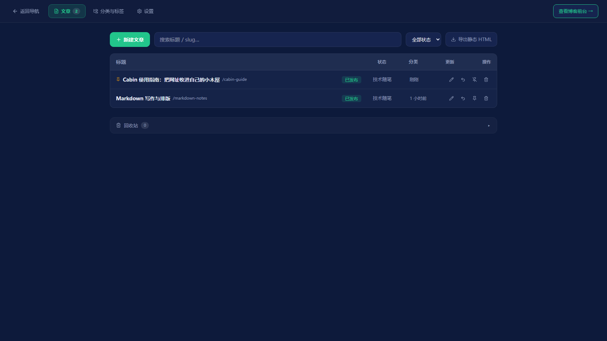

# Cabin · 小木屋 🛖

> 你的**离线个人导航起始页** + **本地博客**——以网址导航为入口，叠加本地写作的博客模块。纯前端、零后端、零账号，数据全部存在你自己的浏览器（SQLite）里。

<p align="center">
  
</p>

---

## ✨ 功能特性

### 导航站

| 功能 | 说明 |
|------|------|
| 🗂️ 标签分类 | 常用 / 工具 / 学习 / 娱乐开箱即用；右键编辑 / 设默认 / 删除，**拖拽排序** |
| 🔗 网站卡片 | favicon + 名称 + 域名 + 描述悬浮，点击计数，网格 / **分区布局** 双视图 |
| 🔍 多搜索引擎 | 顶部搜索框切换 本地 / 百度 / 必应 / Google / GitHub，**回车即搜**，支持自定义引擎（默认引擎禁用/删除自动转移） |
| ⌨️ Alt+K 全局搜索 | 毛玻璃浮层聚焦搜索，↑↓ 选择、Enter 直达 |
| 📥 批量导入 | 浏览器书签 HTML、CSV，**拖拽到卡片即可导入**，导入前勾选预览 |
| 🔗 断链检测 | 批量校验书签可访问性（HEAD→GET、可取消），卡片红点标记 +「仅看失效」筛选 |
| 🤖 自动抓元数据 | 添加网站填 URL 自动抓标题 / 描述 / 图标（Jina → allorigins 降级，纯客户端） |
| 💾 备份与版本历史 | JSON 导出（合并/整库替换）、SQLite `.db` 导出、**自动存档**（5 分钟防抖、同日去重、保留 10 份、一键恢复） |
| 🖼️ 壁纸 + 主题 | 渐变预设 / 本地图片（存本地）、遮罩透明度；暗 / 亮主题 + 跟随系统 |
| 📦 浏览器内 SQLite | `sql.js`（WASM）真 SQLite，二进制持久化到 IndexedDB |

### 博客（本地写作与阅读）

| 功能 | 说明 |
|------|------|
| 📖 前台阅读 | 搜索 / 分类 pill / 标签 pill / 6 种排序（置顶恒前）/ 分页、文章卡片（渐变封面 + 置顶徽章）、详情页（Markdown 排版 + 相关文章） |
| 🛠️ 后台管理 | Tab 式（文章 / 分类与标签 / 设置）、文章表格操作（发布 / 撤回 / 置顶 / 删除）、**回收站**（恢复 / 彻底删除） |
| ✍️ 全屏编辑器 | Markdown 三视图（编辑 / 分栏 / 预览）、工具栏、**自动保存**、发布校验（标题 / slug / 正文）、实时字数与阅读时长 |
| 📤 静态导出 | 一键导出**单文件 HTML 博客**（草稿不外泄），可直接拷贝分享 |
| 🔒 安全渲染 | markdown-it `html:false`，防 XSS；数据与导航同一本地 SQLite |

<p align="center">
  
</p>

---

## 🚀 快速开始

```bash
npm install

npm run dev        # 开发：http://localhost:5173

npm run build      # 构建 dist/（sql-wasm.wasm 已内联为 data URL）
npm run preview    # 预览构建产物
```

> 构建产物 `dist/` 可部署到**任意静态服务器**（Nginx / GitHub Pages / PM2 serve）。首次打开自动建库并种子默认标签与内置搜索引擎。
> 进入博客：顶栏右侧 **📖** 按钮；博客内「管理」进入后台。

## 📸 更多截图

| 分区布局 | 博客详情 |
|---------|---------|
|  |  |

| 博客后台 |
|---------|
|  |

## 💾 数据存储

全部数据在浏览器本地 SQLite（WASM），IndexedDB 中 `cabin-sqlite` → `sqlite` store：

| 表 | 用途 |
|----|------|
| `tabs` / `navigations` | 标签与网站（含断链检测结果 `is_valid`） |
| `settings` / `meta` | 应用设置与迁移信息 |
| `search_engines` | 搜索引擎（内置 + 自定义，默认引擎状态机） |
| `backups` | 自动存档（环形保留 10 份） |
| `blog_posts` / `blog_categories` / `blog_tags` / `blog_settings` | 博客文章 / 分类 / 标签 / 设置 |

- 写后 500ms 防抖落盘，页面关闭前兜底保存
- 清除数据：F12 → Application → IndexedDB → 删除 `cabin-sqlite`
- 迁移：旧设备导出 `.db` 或 JSON，新设备导入即可

## 🛠️ 开发指南

### 环境要求

- **Node.js** ≥ 22.12、npm；开发端口 `http://localhost:5173`

### 常用命令

```bash
npm run dev / build / preview / typecheck

# 纯函数单测（node --experimental-strip-types，共 6 组）
npm run test            # 全量
npm run test:nav        # 导航核心（slug/排序/判重/URL 防 XSS）
npm run test:import     # 书签 HTML / CSV 解析
npm run test:backup     # 备份信封校验与合并
npm run test:engine     # 搜索引擎状态机（默认转移）
npm run test:meta-link  # 元数据解析 / 断链检测 / 存档环
npm run test:blog       # 博客核心（slug/状态机/筛选排序/工具栏/静态导出）
```

### 项目结构

```
Cabin/
├── index.html / vite.config.ts
├── public/                 # favicon.svg / logo.svg（小木屋插画）/ logo-full.svg
├── docs/screenshots/       # README 截图
├── src/
│   ├── main.ts             # 入口（Element Plus zh-cn + 全局样式）
│   ├── App.vue             # 视图切换：导航站 / 博客前台 / 博客后台
│   ├── components/         # 导航组件（Header/TabBar/StatsBar/NavGrid/弹窗…）
│   │   └── blog/           # 博客：BlogFront / BlogAdmin / BlogEditor
│   ├── composables/ui.ts   # 弹窗与视图联动总线
│   ├── core/               # 纯逻辑（可单测）：navCore / importCore / backupCore /
│   │                       #   engineCore / linkCheckCore / metadataCore / backupRing /
│   │                       #   blogCore / blogRender / iconSet
│   ├── db/                 # sql.js 连接 + repositories + blogRepositories
│   ├── stores/             # cabin（导航）+ blog（博客）
│   ├── styles/             # main.css 主题变量 + markdown.css 正文排版
│   └── types/index.ts
└── scripts/                # 6 组纯函数单测
```

### 关键约定

- 一律 `<script setup lang="ts">`；**纯逻辑下沉 `src/core/*.ts`**（node 直接单测），组件内不重算
- 路径别名 `@` → `/src`；组件专属样式写 SFC `<style scoped>`，共享样式进 `src/styles/`
- IndexedDB/SQLite 写入前剥 Vue reactive Proxy；写后防抖持久化
- 图标统一走 `AppIcon`（`lucide:` 前缀矢量图标，兼容旧 emoji 数据）
- 提交信息：中文、前缀 `feat-` / `fix-` / `chore-`

### 隐私说明

- 无硬编码密钥、无账号、无后端；断链检测 / 元数据抓取 / favicon 使用公共 HTTPS 服务（可失败降级，不存任何数据）
- 本地博客纯离线书写，唯一"外发"动作是你主动点的「导出静态 HTML」

## 📄 License

[MIT](./LICENSE)
